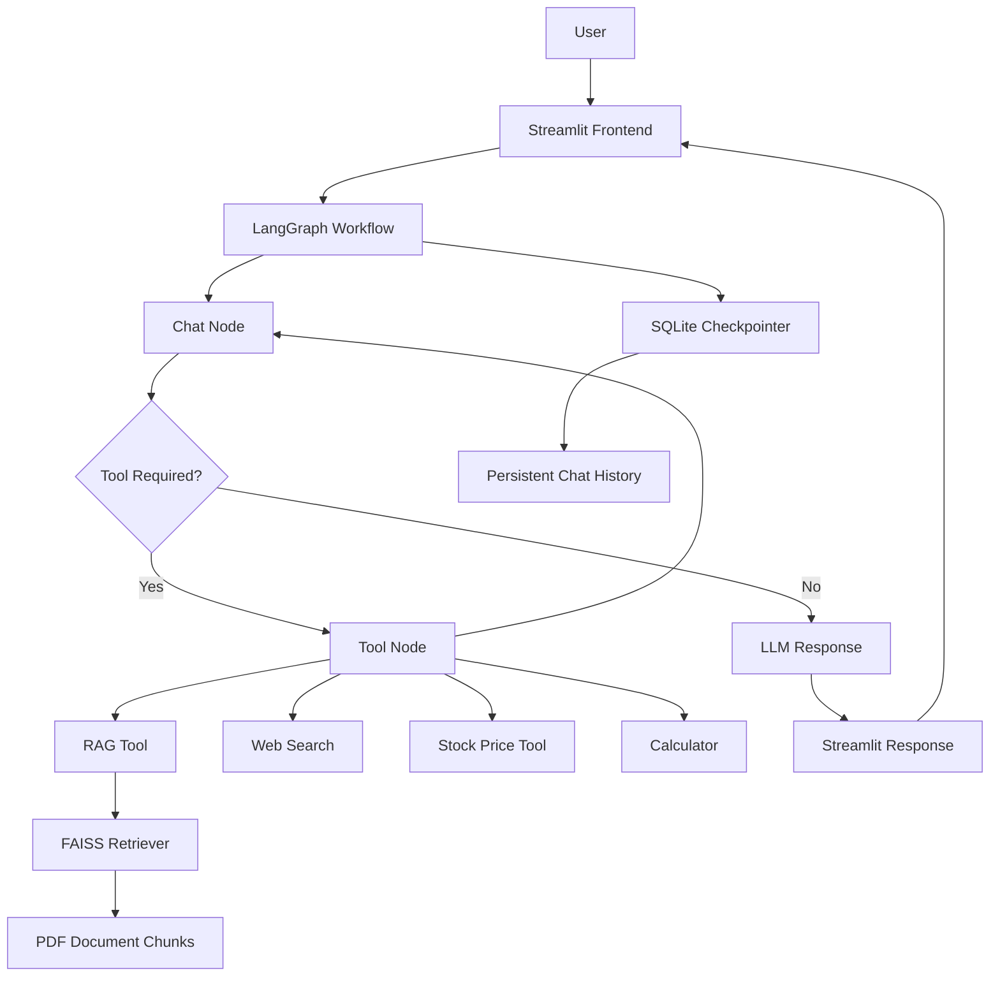

# 🤖 Multi-Utility AI Chatbot | LangGraph + RAG

An intelligent multi-utility chatbot built using **LangChain, LangGraph, Streamlit, and Generative AI**. The application combines Retrieval-Augmented Generation (RAG), tool calling, web search, stock price lookup, mathematical calculations, and persistent conversational memory into a single AI-powered assistant.

Users can upload PDF documents, ask context-aware questions, search the web, fetch stock market information, and perform calculations through an interactive conversational interface.

---

## 🚀 Features

- **📄 PDF Question Answering (RAG):** Upload PDF documents and ask questions based on their content.
- **🔍 Semantic Search:** Retrieve relevant document chunks using vector embeddings and FAISS.
- **🌐 Web Search:** Search the internet using DuckDuckGo.
- **📈 Stock Price Lookup:** Fetch stock market information using the Alpha Vantage API.
- **🧮 Calculator Tool:** Perform addition, subtraction, multiplication, and division.
- **🧠 Conversational Memory:** Maintain context across multiple messages.
- **💾 Persistent Chat History:** Save conversation checkpoints using SQLite.
- **💬 Multi-threaded Conversations:** Create new chats and switch between previous conversations.
- **⚡ Streaming Responses:** Stream AI-generated responses in the Streamlit interface.
- **🔧 Agentic Tool Calling:** Dynamically select and execute tools using LangGraph.

---

## 🛠️ Tech Stack

| Technology | Purpose |
|---|---|
| Python | Core programming language |
| LangChain | LLM integration, tools, document processing |
| LangGraph | Agent workflow, state management, tool execution |
| Streamlit | Interactive frontend |
| OpenRouter | LLM API provider |
| NVIDIA Nemotron | Language model |
| Google Gemini Embeddings | Text embedding generation |
| FAISS | Vector similarity search |
| SQLite | Persistent conversation checkpoints |
| PyPDFLoader | PDF document extraction |
| DuckDuckGo Search | Web search |
| Alpha Vantage API | Stock market data |
| RecursiveCharacterTextSplitter | Document chunking |
| Requests | API communication |
| Python-dotenv | Environment variable management |

---

## 🏗️ Architecture



---

## 🔄 Workflow

### 1. PDF Ingestion

1. User uploads a PDF document through the Streamlit sidebar.
2. The PDF is loaded using `PyPDFLoader`.
3. Document content is split into smaller chunks using `RecursiveCharacterTextSplitter`.
4. Each chunk is converted into embeddings using Google Gemini Embeddings.
5. Embeddings and document chunks are stored in a FAISS vector store.
6. A retriever is created to fetch the top 4 relevant chunks.

### 2. Query Processing

1. User submits a query through the chat interface.
2. The query is sent to the LangGraph chatbot.
3. The LLM analyzes the query and determines whether a tool is required.
4. If a tool is needed, LangGraph routes the request to the appropriate tool.

### 3. Tool Execution

The chatbot supports four tools:

| Tool | Description |
|---|---|
| `rag_tool` | Retrieves relevant information from uploaded PDFs |
| `DuckDuckGoSearchRun` | Performs web searches |
| `get_stock_price` | Fetches stock information using Alpha Vantage |
| `calculator` | Performs mathematical calculations |

### 4. Response Generation

- Tool results are returned to the LLM.
- The LLM uses the retrieved information to generate a contextual response.
- Responses are streamed to the Streamlit interface.

### 5. Conversation Persistence

- Each conversation is identified by a unique `thread_id`.
- LangGraph checkpoints conversation state.
- SQLite stores chat checkpoints.
- Users can create new chats and revisit previous conversations.

---

## 📄 RAG Pipeline


### Document Processing Configuration

| Parameter | Value |
|---|---|
| Chunk Size | 1000 characters |
| Chunk Overlap | 200 characters |
| Embedding Model | `gemini-embedding-2` |
| Vector Store | FAISS |
| Retrieval Method | Similarity Search |
| Number of Retrieved Chunks | 4 |

---

## 🧠 LangGraph Workflow

The chatbot workflow is implemented using `StateGraph`.

```text
START
  |
  v
Chat Node
  |
  v
Tool Decision
  |
  +---- No Tool ----> Final Response
  |
  +---- Tool Required
           |
           v
       Tool Node
           |
           v
       Chat Node
           |
           v
      Final Response
```

### Components

- **Chat Node:** Invokes the LLM and generates responses or tool calls.
- **Tool Node:** Executes the requested tools.
- **tools_condition:** Determines whether the LLM response contains tool calls.
- **add_messages:** Maintains message state in the graph.
- **SqliteSaver:** Stores graph checkpoints in SQLite.

---

## 📂 Project Structure

```text
AI-Project/
│
├── langgraph_rag_backend.py
├── streamlit_rag_frontend.py
├── requirements.txt
├── README.md
├── .gitignore
│
├── chatbot.db              # SQLite database (generated locally)
├── .env                    # API keys (not committed)
├── myenv/                  # Python virtual environment
│
└── __pycache__/
```

---

## ⚙️ Installation & Setup

### 1. Clone the Repository

```bash
git clone https://github.com/YOUR_USERNAME/YOUR_REPOSITORY.git
```

```bash
cd YOUR_REPOSITORY
```

### 2. Create a Virtual Environment

Using Python:

```bash
python -m venv myenv
```

Activate the environment on Windows:

```powershell
.\myenv\Scripts\Activate.ps1
```

### 3. Install Dependencies

```bash
pip install -r requirements.txt
```

Alternatively, using `uv`:

```bash
uv pip install -r requirements.txt
```

### 4. Configure Environment Variables

Create a `.env` file in the project root:

```env
OPENROUTER_API_KEY=your_openrouter_api_key
GOOGLE_API_KEY=your_google_api_key
ALPHA_VANTAGE_API_KEY=your_alpha_vantage_api_key
```

Obtain your API keys:

- OpenRouter: https://openrouter.ai/keys
- Google AI Studio: https://aistudio.google.com/apikey
- Alpha Vantage: https://www.alphavantage.co/support/#api-key

**Important:** Never commit your `.env` file or expose API keys publicly.

### 5. Run the Application

```bash
streamlit run streamlit_rag_frontend.py
```

The application will open in your browser:

```text
http://localhost:8501
```

---

## 💻 Usage

1. Launch the Streamlit application.
2. Upload a PDF document from the sidebar.
3. Wait for the document to be processed and indexed.
4. Ask questions related to the uploaded document.
5. Ask general questions to trigger web search.
6. Ask mathematical questions to use the calculator.
7. Request stock prices using stock symbols.
8. Create new conversations using the **New Chat** button.
9. Switch between previous conversations from the sidebar.

---

## 🔑 Environment Variables

| Variable | Description |
|---|---|
| `OPENROUTER_API_KEY` | API key for accessing LLMs through OpenRouter |
| `GOOGLE_API_KEY` | API key for Google Gemini embeddings |
| `ALPHA_VANTAGE_API_KEY` | API key for stock market data |

---

## 💾 Database & Storage

### SQLite

SQLite is used through LangGraph's `SqliteSaver` checkpointing mechanism.

Database file:

```text
chatbot.db
```

It stores conversation checkpoints associated with individual thread IDs.

### FAISS

FAISS is used for vector similarity search over uploaded PDF documents.

The current implementation maintains thread-specific retrievers in memory.

> **Note:** Conversation checkpoints persist in SQLite, but PDF vector stores are currently maintained in memory. Restarting the application will require re-uploading PDFs to rebuild the retrievers.

---

## 🔮 Future Improvements

- Persistent FAISS indexes across application restarts.
- Support for multiple PDF documents per conversation.
- Document source citations and page references.
- Improved retrieval using hybrid search.
- Reranking retrieved document chunks.
- Enhanced UI with tool execution visualization.
- Authentication and user-specific conversations.
- Docker deployment.
- LLM evaluation and observability integration.
- Advanced agent workflows using LangGraph.

---

## 🎯 Learning Outcomes

This project provided hands-on experience with:

- Retrieval-Augmented Generation (RAG)
- Vector embeddings and semantic search
- LangChain tool integration
- Agentic workflows with LangGraph
- Graph-based state management
- Conversational memory and checkpointing
- SQLite database integration
- External API integration
- Streamlit application development
- LLM streaming and tool calling

---

## 👨‍💻 Author

**Jatin Kapoor**

AI & Generative AI Enthusiast | Python | LangChain | LangGraph | RAG | Machine Learning

---

⭐ If you find this project interesting, feel free to star the repository!
